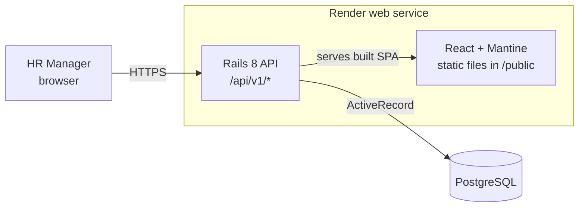

# Design notes

## Architecture



**One deployable.** The React app is built with Vite and copied into Rails' `public/`. Rails
serves the API under `/api/v1` and falls back to `index.html` for client routes. One service means
no CORS, one URL, one thing to deploy. In development, Vite runs on :5173 and proxies `/api` to
Rails on :3000.

### Repository layout
```
backend/   Rails 8 API-only app, PostgreSQL, RSpec
frontend/  Vite + React + TypeScript, Mantine UI, TanStack Query, Vitest + Testing Library
docs/      requirements, design, AI workflow
render.yaml
```

## Domain model

`employees`
| column | type | notes |
|--------|------|-------|
| full_name | string, not null | |
| email | string, not null, unique (case-insensitive) | |
| job_title | string, not null | indexed |
| department | string, not null | indexed |
| country_code | string(2), not null | ISO 3166 alpha-2, indexed |
| salary | decimal(12,2), not null | annual, local currency, > 0 |
| employment_type | string, not null | `full_time` / `part_time` / `contract` |
| hire_date | date, not null | not in the future |

`users`: name, email (unique, case-insensitive), `password_digest` (bcrypt), role
(`hr_manager` / `viewer`).

**Countries are configuration, not a table.** `config/countries.yml` holds code, name, currency and
a USD rate. A `Country` value object reads it. Currency is derived from the country, so an employee
can never have "India + EUR". Adding a country is a one-line config change with a test. The rates
carry a date (`Country::RATES_AS_OF`), and `/meta` returns both, so the Insights page can show
exactly which rates produced each "USD, converted" figure.

Composite index `(country_code, job_title)` backs the most common insight query.

## Backend structure
- **Controllers** stay thin: parse params, call a query/service, render JSON.
- **`EmployeeSearch`** (query object): whitelisted filters, `ILIKE` search, whitelisted sort
  columns/directions, `page`/`per_page` (capped at 100). Returns records + pagination meta.
- **`SalaryInsights`** (query object): pure SQL aggregates — `COUNT`, `MIN`, `MAX`, `AVG`,
  `percentile_cont(0.5)` for the median, USD conversion via a `CASE` built from the country config.
  One query per insight, regardless of row count.
- **`EmployeeSpreadsheet` / `EmployeeImport`** (services): one Excel workbook format shared by export
  and import, so an exported file can be edited in Excel and imported back. See
  [Excel import & export](#excel-import--export).
- **Errors:** 401 `{error}` when signed out; 403 for a viewer trying to write; 404 `{error}`;
  422 `{errors: {field: [messages]}}`; 400 for bad params.

### API (`/api/v1`)
| Method | Path | Purpose |
|--------|------|---------|
| GET | /employees?q=&country=&department=&job_title=&sort=&direction=&page=&per_page= | list |
| GET/POST/PATCH/DELETE | /employees(/:id) | CRUD (writes: HR Manager only) |
| GET | /employees/export?…same filters and sort… | Excel (.xlsx) download |
| POST | /employees/import (multipart `file`, .xlsx or .csv) | Import (HR Manager only) |
| GET/POST/DELETE | /session | current user / sign in / sign out |
| GET | /insights/countries | per-country stats |
| GET | /insights/countries/:code/job_titles | per-title stats in a country |
| GET | /insights/departments | headcount + USD payroll per department |
| GET | /meta | countries (with USD rate), rate date, departments, job titles for dropdowns |

## Authentication & roles
- **Session cookie, not tokens.** The SPA is served from the same origin as the API, so sign-in sets an
  encrypted, `httpOnly`, `SameSite=Lax` Rails session cookie (12-hour expiry). JavaScript can't read
  it (so XSS can't steal it), and `SameSite=Lax` stops other sites from sending it on cross-site
  POST/PATCH/DELETE, which covers CSRF for a JSON API. There's no token to store in `localStorage`.
- **`has_secure_password`** (bcrypt). `User.authenticate_by` takes the same time whether or not the
  email exists, and both failures return the same message, so sign-in doesn't reveal which emails are
  registered. The session id is reset on sign-in (session fixation), and sign-in is rate limited
  (10 attempts / 3 min).
- **Authorization lives in the API.** `ApplicationController` requires a user for every endpoint;
  writes (`create`/`update`/`destroy`/`import`) also require `hr_manager` and return 403 otherwise.
  The UI hides those controls for viewers, but that's convenience, not security.
- **Frontend:** `AuthGate` loads `GET /session` once and shows the sign-in page until there is a user,
  then provides it through React context. Any 401 (an expired session) sends the user back to sign-in.
  Signing out drops all cached salary data from memory.
- **Demo accounts** (`hr@acme.test`, `viewer@acme.test`) are created idempotently on every deploy
  and listed on the login page, because the hosted demo has fictional data and reviewers need to get in.
  A real deployment would use the company's SSO and create no demo accounts.

## Excel import & export
- **Why .xlsx and not CSV.** The first version exported CSV. When HR opened it in Excel and saved it,
  Excel rewrote every hire date in the user's locale (`2024-03-01` came back as `12-12-2025`-style
  text), and the import rightly rejected the file. A CSV also can't carry column widths, so the date
  column showed `####`. A real workbook fixes both: export and import use the same `.xlsx` file.
- **One column definition** (`EmployeeSpreadsheet::COLUMNS`: header, width, cell type) drives the
  export and the importer's required headers, so the two can't drift apart.
- **Export** (`GET /employees/export`) applies exactly the directory's filters and sort (no paging) and
  writes `pluck`ed columns with caxlsx. Hire dates are real date cells formatted `yyyy-mm-dd`, salaries
  are numbers (`#,##0.00`), every column has a readable width, the header row is frozen and filters
  are on. Text cells are explicitly typed as text, so a name like `=HYPERLINK(…)` is never evaluated
  as a formula.
- **Import** (`POST /employees/import`, HR Manager only) detects an `.xlsx` by its content (a zip
  signature), not its file name, and reads it with roo. Typed cells become the same text a CSV cell
  would hold (date cells → `YYYY-MM-DD`), so validation is shared. Blank rows are skipped and errors
  keep Excel's row numbers. CSV with the same columns is still accepted for other tools. Its date error
  explains that Excel rewrites CSV dates and points to the `.xlsx` export. Old binary `.xls` files and
  damaged workbooks get clear messages.
- **All-or-nothing:** every row is validated with the same model validations as the form, plus
  duplicate emails within the file, a currency that doesn't match the country, and unambiguous formats
  (ISO dates, plain numbers). If any row fails, nothing is written and the response lists errors by
  spreadsheet row number (header = row 1). HR fixes the file and uploads it again, and never has to
  work out which half was applied. Rows match on email: known emails update, new emails create.
- **CSV leniency** (for files from other tools): a UTF-8 byte-order mark, Windows line endings,
  `18,50,000`-style thousands separators, and "Full-time" as well as `full_time`. A non-UTF-8 file gets
  a clear "save as CSV UTF-8" message.
- **Writes** are one transaction: `insert_all!` for new rows, `upsert_all` by id for changed rows, and
  unchanged rows are skipped. Existing employees are loaded in one query. The per-row email uniqueness
  query is skipped because the importer matches on email itself, and the unique index still guards the
  table. Limits: 5 MB, 20,000 rows.

## Seeding
`EmployeeSeeder` builds rows with `Random.new(42)` so every run produces the same data. Names come
from first/last name lists; salary = job-level base × country multiplier × ±15% noise, rounded.
Rows are inserted with `insert_all` in batches of 1,000.

## Trade-offs
| Decision | Alternative | Why |
|----------|-------------|-----|
| Offset pagination | Keyset/cursor | Users jump to page N and sort by many columns; offset at 10k rows is cheap. Revisit at 1M+. |
| `ILIKE` search | pg_trgm / full-text | Enough for 10k rows; trigram index is the upgrade path. |
| Country config file | `countries` table + admin UI | Changes rarely; config is versioned and testable. |
| SQL aggregates | Load rows into Ruby | Constant memory, one round trip, Postgres has `percentile_cont`. |
| Single service | Separate static host + API | Simpler deploy, no CORS, one URL in the demo. |
| Cookie session + `has_secure_password` | JWT in `localStorage`, Devise, SSO | Same origin, so an httpOnly cookie is simpler and safer than a token JS can read. Devise brings far more than two roles need. SSO is the real-world answer and the next step. |
| Two fixed roles on `users.role` | Permissions table / Pundit | Two roles with one rule ("only managers write") fit in one `before_action`. Add a policy layer when rules depend on the record (e.g. by country). |
| All-or-nothing import | Import valid rows, skip bad ones | A half-applied salary file is worse than a rejected one. HR fixes the listed rows and re-uploads. |
| `.xlsx` (caxlsx + roo) | CSV | Started with CSV; Excel rewrote its dates on save and CSV can't hold column widths or types. Two gems are worth a file that survives a round trip through Excel. CSV is still accepted on import. |

## Performance notes
Measured locally on the 10,000-employee seed (development mode, single request, warm):

| Request | Time |
|---------|------|
| Seed 10,000 employees (`insert_all`, batches of 1,000) | ~2.3 s |
| `GET /employees` page 1 | 28 ms |
| `GET /employees?q=sharma&country=IN&sort=salary&direction=desc` | 32 ms |
| `GET /employees?page=400` (deep offset) | 43 ms |
| `GET /insights/countries` (incl. median per country) | 52 ms |
| `GET /insights/countries/IN/job_titles` | 37 ms |
| `GET /insights/departments` / `summary` / `meta` | 22–25 ms |
| `GET /employees/export` (all 10,001 rows, ~455 KB .xlsx) | ~2 s |
| `POST /employees/import` of that full export (read + validate 10,001 rows, nothing changed) | ~6.7 s (about 3 s of it is reading the workbook) |

Why it stays fast:
- Every insight is a single aggregate query (`GROUP BY` + `PERCENTILE_CONT`). Ruby never loads the rows.
- Filters and sorts hit indexed columns. The composite `(country_code, job_title)` index covers
  the job-title drill-down.
- `per_page` is capped at 100, and serialization has no N+1 (country data comes from memory, not a join).
- Frontend: TanStack Query caches responses and keeps the previous page on screen while the next one
  loads. Search is debounced (300 ms). The charting library is lazy-loaded with the Insights page.

At ~1M rows, the next steps would be keyset pagination for deep pages, a `pg_trgm` index for
search, and caching or materializing the insight aggregates (they only change when salaries do).

## Known limitations & next steps
1. **Audit trail / salary history**: record who changed which salary, when, and from what (now
   possible since every change has a signed-in user). Salary changes should be traceable.
2. **SSO** instead of passwords, plus user management screens. Finer-grained access (e.g. a viewer
   limited to their own country) would need a policy layer.
3. **Part-time pay skews ranges.** Part-time salaries are stored pro-rated, so they pull down role
   minimums. Add an FTE-adjusted view or a full-time-only filter on Insights.
4. **Large files are handled in the request.** A full 10k-row workbook takes ~2 s to export and
   ~7 s to import. Fine for an occasional HR task, but beyond ~20k rows both should move to a
   background job with progress reporting (and a streaming xlsx reader).
5. **FX rates** are fixed in `config/countries.yml`. If finance needs historical accuracy, store
   rates with an effective date.
