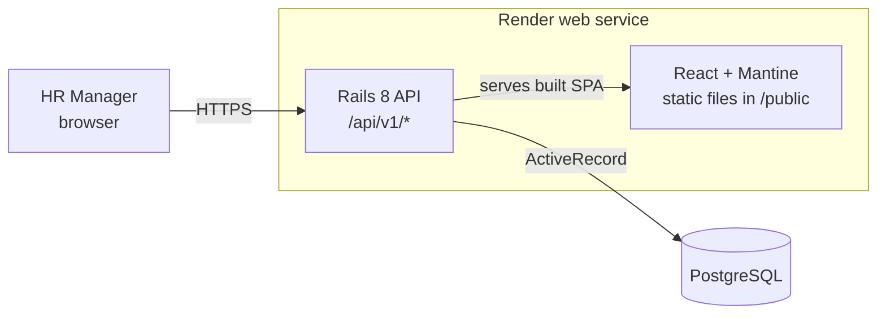

# Design notes

## Architecture



**One deployable.** The React app is built with Vite and copied into Rails' `public/`. Rails
serves the API under `/api/v1` and falls back to `index.html` for client routes. One service means
no CORS, one URL, one thing to deploy. In development, Vite runs on :5173 and proxies `/api` to
Rails on :3000.

### Repository layout
```
backend/   Rails 8 API-only app, PostgreSQL, RSpec
frontend/  Vite + React + TypeScript, Mantine UI, TanStack Query, Vitest + Testing Library
docs/      requirements, design, AI workflow
render.yaml
```

## Domain model

`employees`
| column | type | notes |
|--------|------|-------|
| full_name | string, not null | |
| email | string, not null, unique (case-insensitive) | |
| job_title | string, not null | indexed |
| department | string, not null | indexed |
| country_code | string(2), not null | ISO 3166 alpha-2, indexed |
| salary | decimal(12,2), not null | annual, local currency, > 0 |
| employment_type | string, not null | `full_time` / `part_time` / `contract` |
| hire_date | date, not null | not in the future |

**Countries are configuration, not a table.** `config/countries.yml` holds code, name, currency and
a USD rate. A `Country` value object reads it. Currency is derived from the country, so an employee
can never have "India + EUR". Adding a country is a one-line config change with a test.

Composite index `(country_code, job_title)` backs the most common insight query.

## Backend structure
- **Controllers** stay thin: parse params, call a query/service, render JSON.
- **`EmployeeSearch`** (query object): whitelisted filters, `ILIKE` search, whitelisted sort
  columns/directions, `page`/`per_page` (capped at 100). Returns records + pagination meta.
- **`SalaryInsights`** (query object): pure SQL aggregates — `COUNT`, `MIN`, `MAX`, `AVG`,
  `percentile_cont(0.5)` for the median, USD conversion via a `CASE` built from the country config.
  One query per insight, regardless of row count.
- **Errors:** 404 `{error}`; 422 `{errors: {field: [messages]}}`; 400 for bad params.

### API (`/api/v1`)
| Method | Path | Purpose |
|--------|------|---------|
| GET | /employees?q=&country=&department=&job_title=&sort=&direction=&page=&per_page= | list |
| GET/POST/PATCH/DELETE | /employees(/:id) | CRUD |
| GET | /insights/countries | per-country stats |
| GET | /insights/countries/:code/job_titles | per-title stats in a country |
| GET | /insights/departments | headcount + USD payroll per department |
| GET | /meta | countries, departments, job titles for dropdowns |

## Seeding
`EmployeeSeeder` builds rows with `Random.new(42)` so every run produces the same data. Names come
from first/last name lists; salary = job-level base × country multiplier × ±15% noise, rounded.
Rows are inserted with `insert_all` in batches of 1,000.

## Trade-offs
| Decision | Alternative | Why |
|----------|-------------|-----|
| Offset pagination | Keyset/cursor | Users jump to page N and sort by many columns; offset at 10k rows is cheap. Revisit at 1M+. |
| `ILIKE` search | pg_trgm / full-text | Enough for 10k rows; trigram index is the upgrade path. |
| Country config file | `countries` table + admin UI | Changes rarely; config is versioned and testable. |
| SQL aggregates | Load rows into Ruby | Constant memory, one round trip, Postgres has `percentile_cont`. |
| Single service | Separate static host + API | Simpler deploy, no CORS, one URL in the demo. |
| No auth | Devise / SSO | Single persona; documented as first follow-up. |

## Performance notes
Measured locally on the 10,000-employee seed (development mode, single request, warm):

| Request | Time |
|---------|------|
| Seed 10,000 employees (`insert_all`, batches of 1,000) | ~2.3 s |
| `GET /employees` page 1 | 28 ms |
| `GET /employees?q=sharma&country=IN&sort=salary&direction=desc` | 32 ms |
| `GET /employees?page=400` (deep offset) | 43 ms |
| `GET /insights/countries` (incl. median per country) | 52 ms |
| `GET /insights/countries/IN/job_titles` | 37 ms |
| `GET /insights/departments` / `summary` / `meta` | 22–25 ms |

Why it stays fast:
- Every insight is a single aggregate query (`GROUP BY` + `PERCENTILE_CONT`). Ruby never loads the rows.
- Filters and sorts hit indexed columns. The composite `(country_code, job_title)` index covers
  the job-title drill-down.
- `per_page` is capped at 100, and serialization has no N+1 (country data comes from memory, not a join).
- Frontend: TanStack Query caches responses and keeps the previous page on screen while the next one
  loads. Search is debounced (300 ms). The charting library is lazy-loaded with the Insights page.

At ~1M rows, the next steps would be keyset pagination for deep pages, a `pg_trgm` index for
search, and caching or materializing the insight aggregates (they only change when salaries do).

## Known limitations & next steps
1. **Authentication** (SSO for HR staff) and an **audit trail / salary history** table, since
   salary changes should be traceable.
2. **CSV import/export** to migrate off the existing Excel files.
3. **Part-time pay skews ranges.** Part-time salaries are stored pro-rated, so they pull down role
   minimums. Add an FTE-adjusted view or a full-time-only filter on Insights.
4. **FX rates** are fixed in `config/countries.yml`. If finance needs historical accuracy, store
   rates with an effective date.
